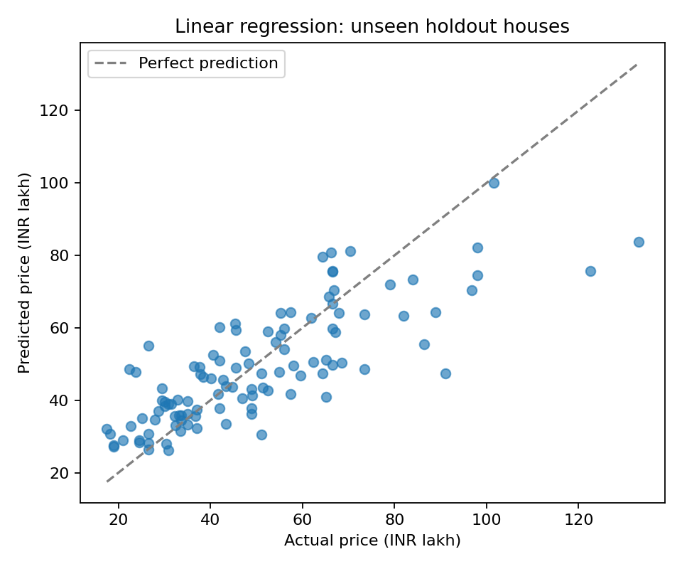
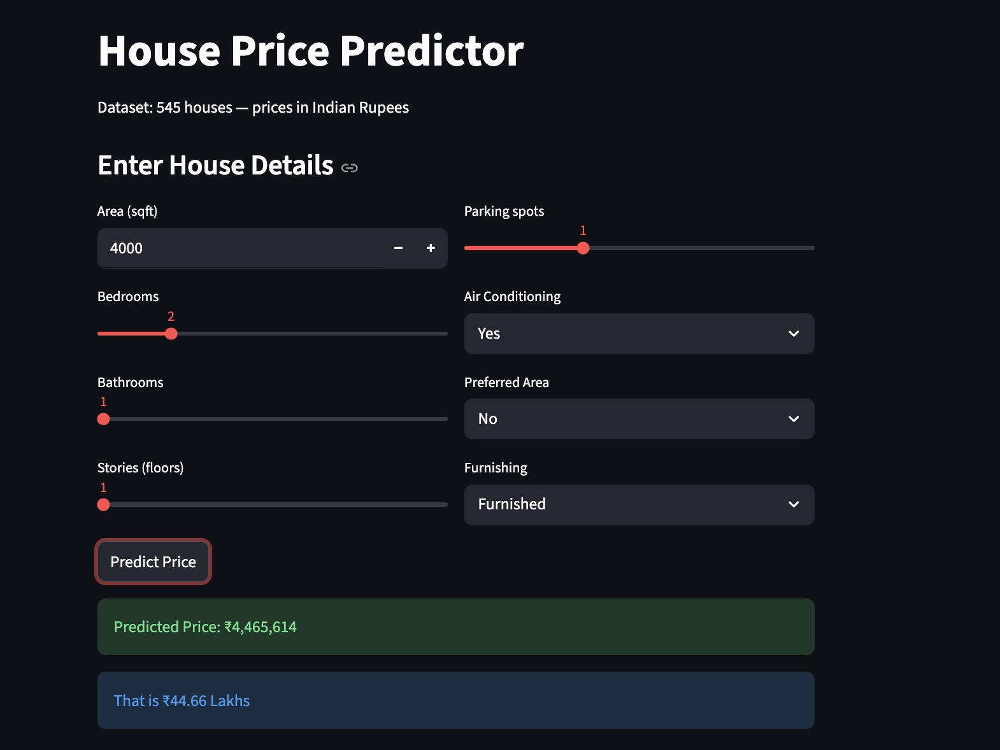
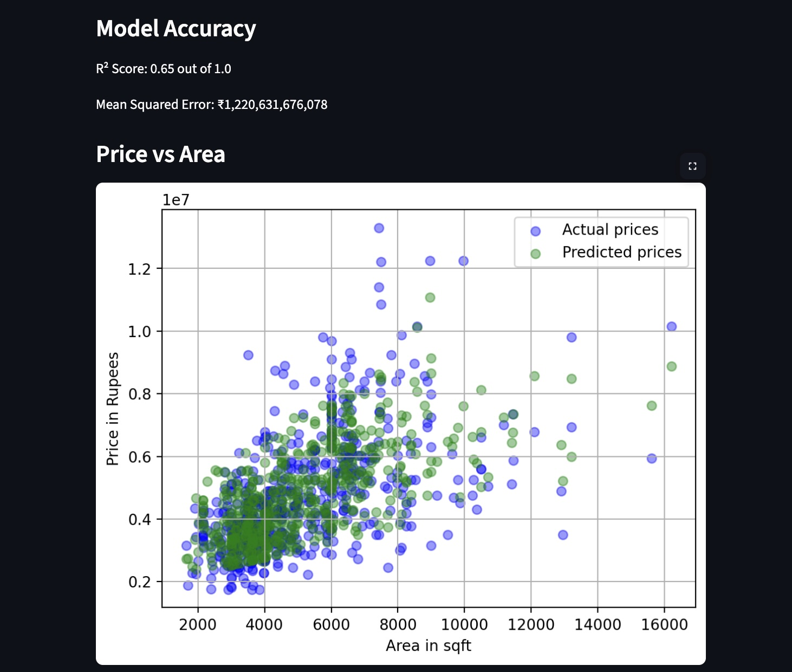

# Housing Price Prediction System

An educational housing-price regression project with a Streamlit interface, a reproducible train/test split, and a training-mean baseline. Given eight property attributes, it estimates the dataset's price target and measures errors on houses excluded from training.

**Suggested GitHub About description:** Housing-price regression demo with Streamlit, one-hot preprocessing, reproducible holdout evaluation, and a baseline comparison.

[Live demo](https://housing-price-prediction-system-vugxmm5pcogtxgroxcd6nd.streamlit.app/) — the deployed version may differ until these changes are merged and redeployed.

## Problem and scope

Can a simple linear model outperform predicting the same average price for every house? This project demonstrates tabular preprocessing, regression, evaluation and an interactive prediction workflow. It is a learning project, not a validated valuation service for the Indian housing market.

## Dataset and provenance

`HousingData.csv` is included so the evaluation can run without a download:

| Property | Verified from the checked-in CSV |
|---|---|
| Rows / total columns | 545 / 13 (including the target) |
| Target | `price` |
| Price range | 1,750,000–13,300,000 |
| Mean price | 4,766,729.25 |
| Exact duplicate rows | 0 |
| Model inputs | `area`, `bedrooms`, `bathrooms`, `stories`, `parking`, `airconditioning`, `prefarea`, `furnishingstatus` |
| Columns excluded from this version | `mainroad`, `guestroom`, `basement`, `hotwaterheating` |

The previous README attributed the data to a Kaggle “Housing Price Dataset,” but the repository contains no exact source URL, license, collection dates or geographic documentation. Whether the records are real or synthetic is **unverified**. INR display follows the original app's convention; the CSV alone does not establish currency or area units. The previous sqft label is therefore replaced with “dataset units.” Verify provenance and permitted reuse before expanding or republishing the dataset.

## Reproducible setup

Use Python 3.11. Commands below are run from the repository root:

```bash
git clone https://github.com/uniqueqamar/Housing-Price-Prediction-System.git
cd Housing-Price-Prediction-System
python3.11 -m venv .venv
source .venv/bin/activate
# Windows PowerShell: .venv\Scripts\Activate.ps1
python -m pip install -r requirements.txt
python evaluate.py --output-dir reports
python -m unittest discover -s tests -v
python -m streamlit run housing.py
```

Dependencies are version-pinned. Data paths resolve relative to the code, so launching the scripts from another working directory also works. No API key or model download is required.

## Model and evaluation

- Fixed 80/20 random split with seed 42: **436 training / 109 holdout rows**.
- A scikit-learn pipeline passes numeric features through and one-hot encodes categorical inputs. Preprocessing is fitted only on training rows; furnishing is not assigned an artificial numerical order.
- Ordinary least-squares linear regression is compared with `DummyRegressor(strategy="mean")`, fitted on the same training rows.
- The app uses the same training-only model and holdout metrics as the CLI. It does not refit on all records after evaluation.

Results below were computed from the checked-in CSV; machine-readable results and its SHA-256 are in [`reports/metrics.json`](reports/metrics.json).

| Model | MAE (INR display convention) | RMSE (INR display convention) | R² |
|---|---:|---:|---:|
| Linear regression | 1,016,907 | 1,377,904 | 0.6244 |
| Training-mean baseline | 1,748,625 | 2,268,298 | -0.0179 |

MAE is average absolute error; RMSE penalizes larger errors. Lower values are better. R² is a relative goodness-of-fit measure, **not percentage accuracy**, and can be negative. Unlike the previous app's training-set scores, these values evaluate unseen rows. They describe one split of this dataset, not real-world reliability.



The dashed line represents perfect predictions. Scatter away from it exposes prediction errors rather than concealing them in a training fit.

## Interface screenshots

The existing screenshots below document the **earlier interface**. Their training metrics and labels do not represent the updated holdout evaluation.




## Repository structure

```text
housing.py                 Streamlit inputs, predictions and holdout visualization
modeling.py                Shared loading, preprocessing, training and metrics
evaluate.py                CLI producing JSON metrics and a holdout plot
HousingData.csv            Checked-in dataset
requirements.txt           Pinned runtime dependencies
reports/                   Reproducible evaluation outputs
tests/test_modeling.py      Holdout, baseline and category checks
.github/workflows/checks.yml  Automated tests and evaluation
```

## Limitations and next improvements

The dataset is small, provenance is incomplete, and location and time are absent. A random split cannot establish geographic or future-market generalization. Linear regression can miss nonlinear relationships and return implausible values; the app flags negative predictions. Input bounds do not guarantee a combination resembles training data. Predictions have no calibrated uncertainty interval, and average errors can hide poor performance on expensive homes.

Prioritize these follow-ups:

1. Identify the exact source, license, units, location and collection dates. Replace the data with a documented dataset if necessary.
2. Compare all available attributes and Ridge regression using cross-validation on training rows only. Reserve a fresh final test set if repeatedly selecting models against this holdout.
3. Investigate residuals and price-band errors, then add justified features and calibrated prediction intervals.
4. Capture fresh screenshots after deployment. Keep measured results tied to the exact dataset and evaluation procedure.

These changes make the current work easier to inspect and reproduce; stronger market claims require stronger data and validation.
